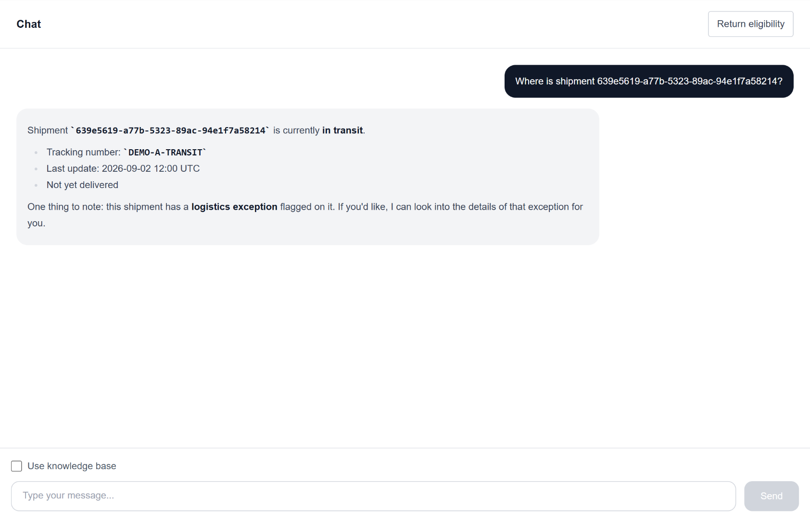
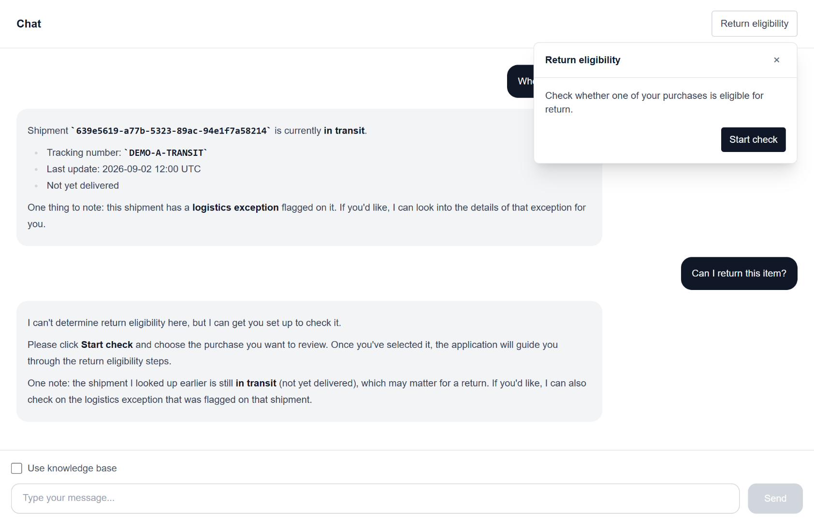
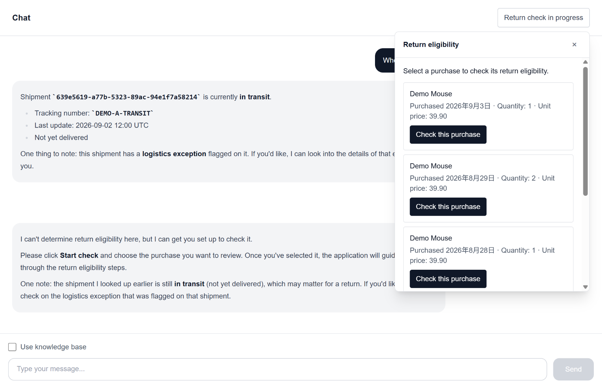
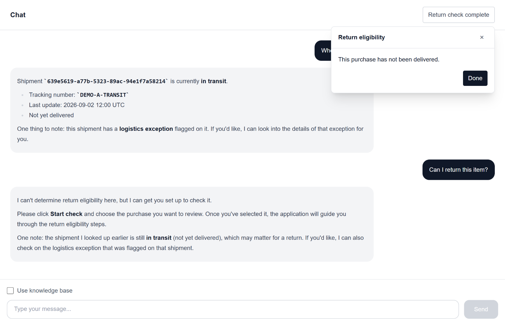
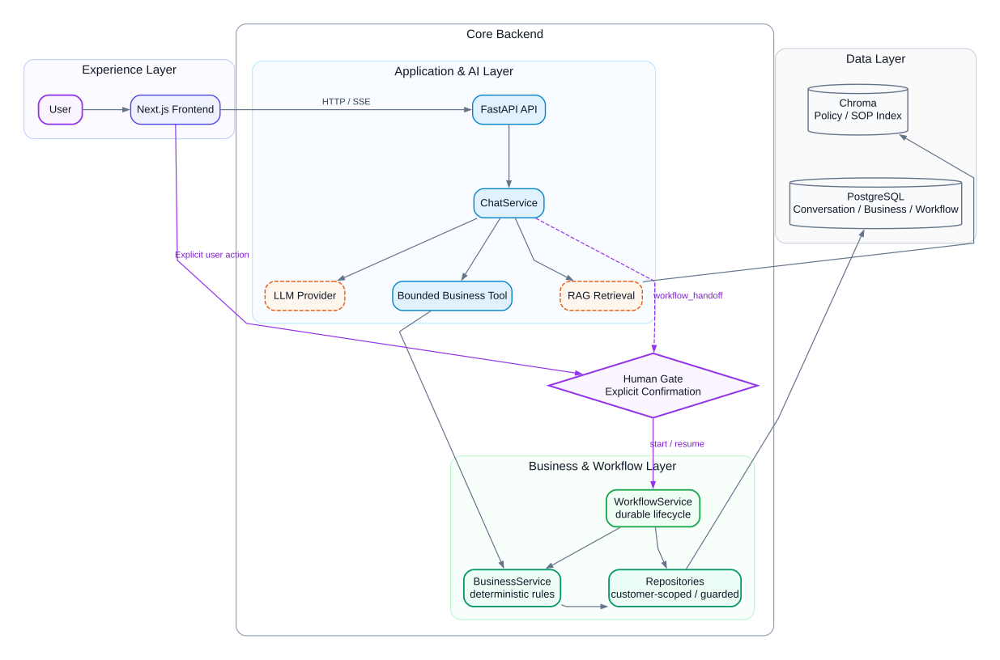

# AI Customer Support System

**电商售后 AI 应用 · Business AI Application**

AI Customer Support System 是一个面向电商售后场景的全栈 AI 应用。用户可以在同一会话中查询物流状态、发起退货资格检查、选择具体购买项，并获得退货资格结果。

系统使用 LLM 理解用户意图并调用受控工具，但订单、物流和 Workflow 状态由应用服务与 PostgreSQL 管理，退货资格由应用服务按照确定性业务规则计算；需要用户确认的步骤不会由模型自动执行。

`Next.js · FastAPI · PostgreSQL · SQLAlchemy · Alembic · Chroma · SSE · DeepSeek / Mock`

## 项目背景与定位

这是一个个人 AI 应用工程实践与作品展示项目，由本人完成整体方案设计、开发实现、工程验证与公开版本整理。

项目重点是探索 LLM、Tool Calling、RAG 和 Workflow 与传统业务系统的结合方式，同时明确 LLM 与业务数据、确定性规则、用户确认及状态持久化之间的职责边界。

项目中的订单、物流、购买记录及售后规则均为模拟数据与演示规则，不代表任何真实电商平台的生产系统。

本仓库为整理后的公开展示版本，公开 Git 历史从整理发布时建立的基线提交开始。

## 核心业务流程

用户先查询物流状态，再提出退货问题。AI 提供退货资格检查入口，用户明确启动检查并选择购买项，系统随后执行规则判断并保存 Workflow 状态。

### Step 1 · 查询物流状态



模型调用受控工具读取当前客户的物流数据，后端按业务规则识别物流异常。

### Step 2 · 发起退货资格检查



用户提出退货问题后，AI 提供退货资格检查入口，但不会自动启动资格判断流程。

### Step 3 · 选择购买项



用户明确选择需要检查的购买项，系统再继续执行资格判断。

### Step 4 · 查看资格结果



后端根据订单状态和售后规则计算资格结果，并保存 Workflow 状态。

## 核心设计

系统将自然语言理解、业务数据访问、规则判断和用户确认分别交由不同模块负责，业务事实和资格判断不会直接交给 LLM。

| 模块 | 主要职责 |
| --- | --- |
| **LLM + Tool Calling** | 理解用户请求、选择受支持的工具并生成回复 |
| **Application / BusinessService** | 读取当前客户的业务数据，执行物流异常和退货资格规则 |
| **RAG** | 检索售后政策与 SOP，为模型回复提供知识上下文 |
| **用户确认 + Workflow** | 用户显式启动检查并选择购买项，Workflow 状态持久化到 PostgreSQL |

实时物流状态由应用服务从数据库读取，退货资格则基于业务数据和确定性规则计算，不会由 RAG 检索结果或 LLM 自行推断。Workflow 通过状态校验和并发保护控制状态流转，避免重复执行。

## 系统架构



- AI 层负责语义理解、选择受支持的工具并生成回复。
- 应用 / 业务层通过 BusinessService 仅访问当前客户的业务数据并执行确定性规则；需要用户确认的步骤必须由用户操作触发。
- PostgreSQL 持久化会话、业务数据和 Workflow 状态，Chroma 仅保存政策与 SOP 的向量索引。

完整组件职责、关键路径与职责边界见 [Current System Architecture](docs/architecture/CURRENT_SYSTEM_ARCHITECTURE.md)。

## 个人贡献

项目的整体方案、前后端实现、工程验证和公开版本整理由本人负责，主要工作包括：

- 设计并实现 LLM 与业务系统之间的职责边界，使模型负责意图理解、受控 Tool 选择与回复生成，而业务事实、权限范围和确定性规则由应用服务与数据库负责。
- 完成基于 FastAPI、PostgreSQL 的后端与 Next.js 前端实现，包括会话持久化、SSE 流式交互、业务数据访问、Tool Calling 以及需要用户确认的 Workflow 交互。
- 集成并验证 RAG、Tool Calling、Human Gate、Workflow 状态流转、异常处理和日志追踪，并通过测试、构建与运行验证关键行为。
- 整理系统架构、运行文档、业务演示与验证证据，形成当前公开展示版本。

开发过程中使用 AI 工具辅助代码检索、方案分析、局部实现与验证；需求判断、架构选择、范围控制、代码 Review 与最终验收由本人负责。具体实践见 [AI 辅助开发实践](docs/engineering/AI_ASSISTED_ENGINEERING_WORKFLOW.md)。

## 工程验证

当前仓库已通过以下工程验证：

| 范围 | 当前验证证据 |
| --- | --- |
| Backend | `pytest`：59 / 59 passed |
| Frontend | `npm run lint` PASS；production build PASS |
| CI | GitHub Actions 执行 backend pytest、frontend lint / build |
| Schema / Data | PostgreSQL、Alembic migrations、deterministic fixtures |
| Runtime | health/readiness、SSE streaming、conversation persistence、Tool / Workflow verification |

仓库同时保留回归测试、业务规则与 Workflow 验证脚本、检索评估和运行就绪检查，便于继续核查实现细节。

## 本地运行

已验证环境：

- Python 3.10
- Node.js 24
- Docker / Docker Compose

Mock provider 无需 API Key，可用于本地运行和验证；如需真实模型调用，可切换为 DeepSeek provider。

运行方式：

```text
PostgreSQL + FastAPI -> Docker Compose
Next.js              -> local Node.js process
```

完整且经过验证的启动步骤见 [Runtime Configuration](docs/engineering/RUNTIME_CONFIGURATION.md)。该文档包含环境配置、Alembic 数据库迁移、确定性演示数据初始化、前后端启动、可选的 RAG 知识入库和 DeepSeek 配置。确定性演示数据是运行上述业务流程所需的数据；仅查看核心应用时不要求启用 RAG。

## 相关文档

- [Current System Architecture](docs/architecture/CURRENT_SYSTEM_ARCHITECTURE.md) — 查看完整组件职责、数据流与边界说明。
- [Runtime Configuration](docs/engineering/RUNTIME_CONFIGURATION.md) — 查看环境配置、数据库迁移、fixtures、RAG 初始化与启动验证。
- [AI 辅助开发实践](docs/engineering/AI_ASSISTED_ENGINEERING_WORKFLOW.md) — 了解项目如何使用 AI 辅助代码理解、实现与验证，以及如何通过 Review 和工程验证控制生成代码风险。
- [Backend tests](backend/tests/) — 查看确定性回归与可观测性测试。
- [Verification scripts](backend/app/scripts/) — 查看业务读取、规则、Tool、Workflow、fixtures 与检索评估。
- [Alembic migrations](backend/alembic/) — 查看 PostgreSQL schema 演进。
- [Backend source](backend/app/) — 查看 FastAPI、应用服务、repositories、RAG 与 provider integration。
- [Frontend source](frontend/src/) — 查看 Next.js chat、SSE、会话状态与 Workflow UI。

## 实现范围与限制

- 当前实现聚焦电商售后中的物流查询与退货资格检查。
- Workflow 负责资格检查和状态流转，不执行实际退款、退货创建或订单修改。
- 系统同时支持 Mock 和 DeepSeek provider；Mock 可用于无需 API Key 的本地验证，DeepSeek 用于真实模型调用。
- RAG 当前用于检索售后政策与 SOP；订单和物流状态由应用服务从 PostgreSQL 读取，退货资格由应用服务按照业务规则判断。
- 当前演示用户身份由应用侧固定上下文提供，尚未接入真实用户认证和多用户隔离机制。

## 作者与许可

项目由 [ziqicongdonglai](https://github.com/ziqicongdonglai) 开发与维护，用于 AI 应用工程实践、技术交流和个人作品展示。

项目采用 [MIT License](LICENSE) 开源。使用、修改或再分发时，请遵守许可证要求并保留原始版权及许可声明。

Copyright © 2026 ziqicongdonglai.
